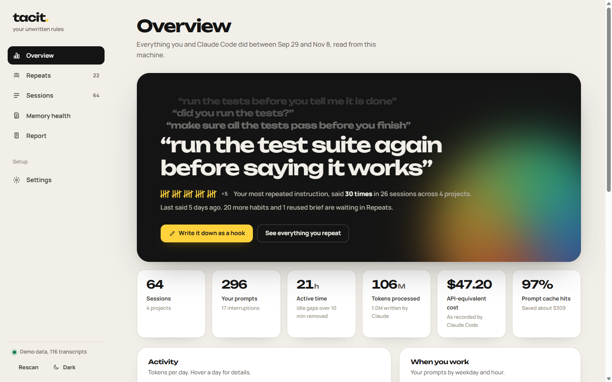
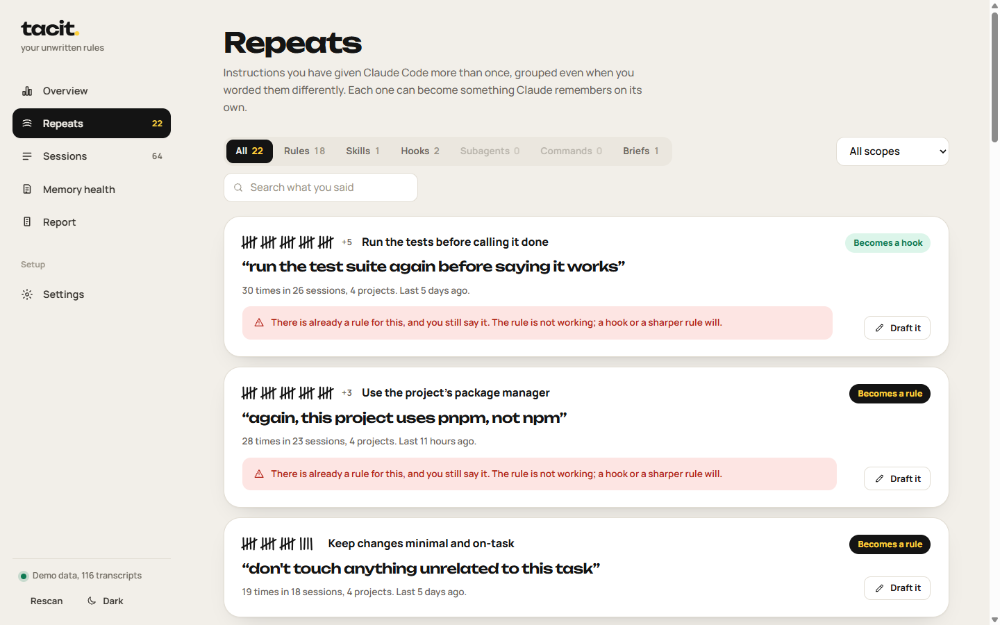
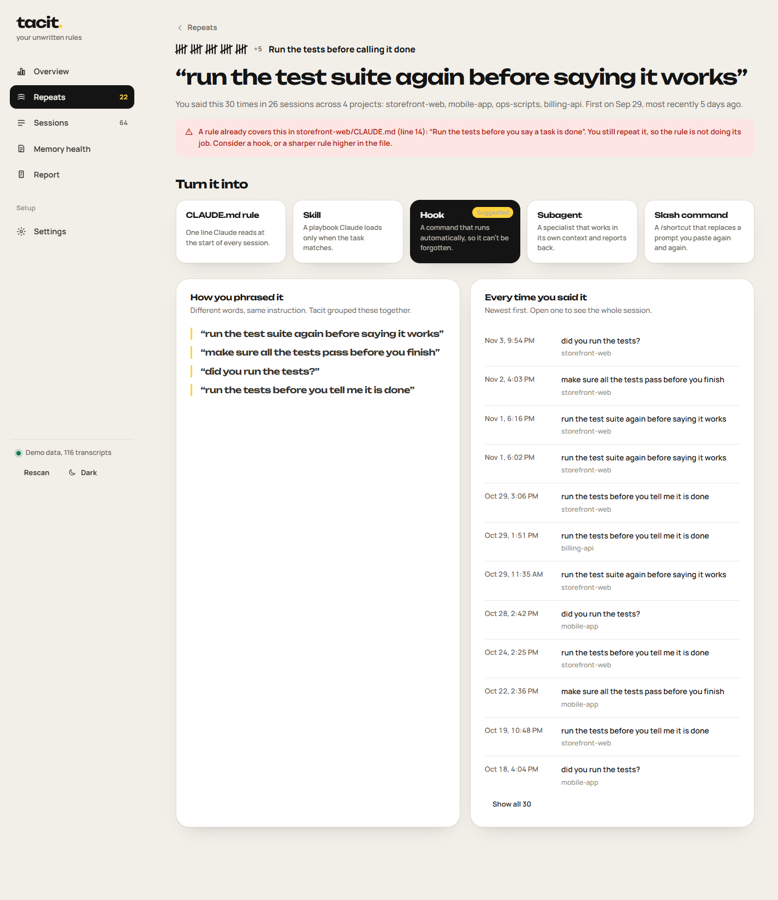
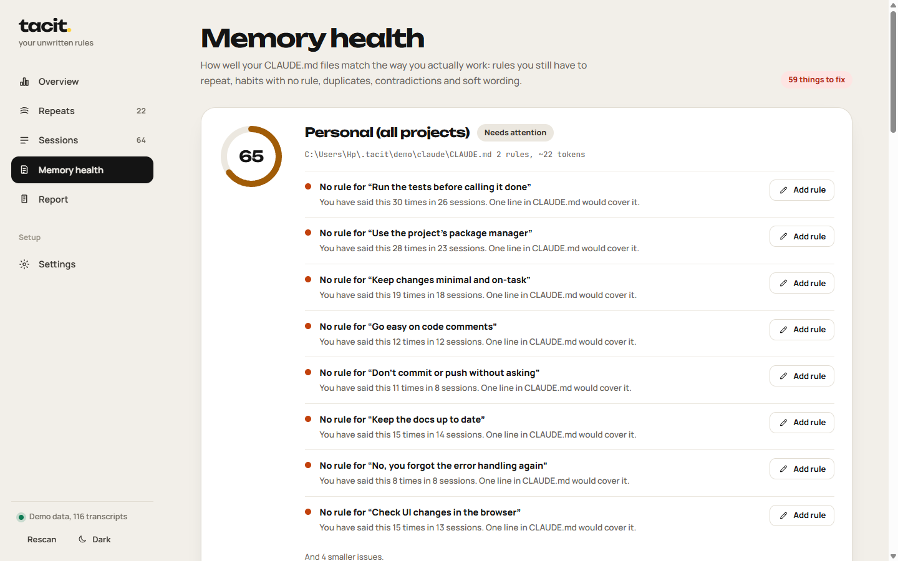
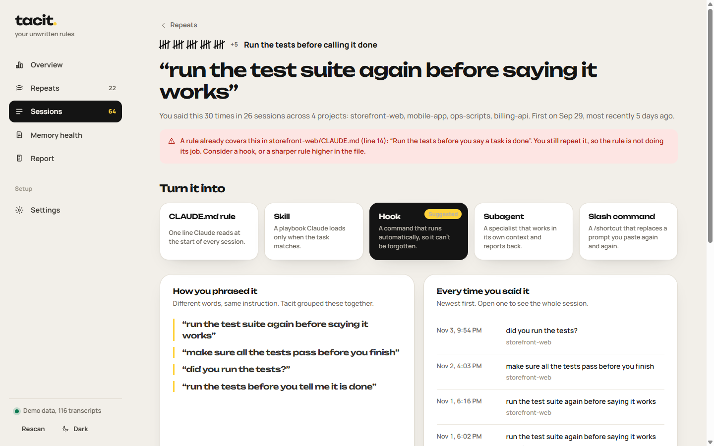
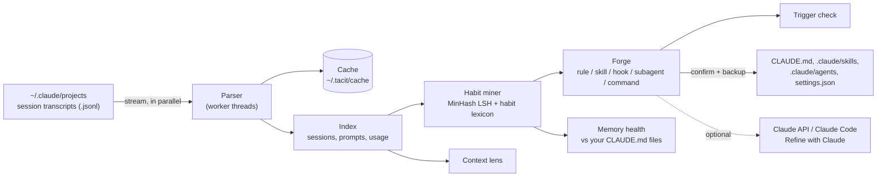

<div align="center">

# tacit.

**Find what you keep telling Claude Code, and write it down once.**

Tacit reads your Claude Code history on your own machine, finds the instructions you repeat across sessions,
and turns each one into a CLAUDE.md rule, a Skill, a hook, a subagent or a slash command.

[](https://github.com/abuhuraira99/tacit/actions/workflows/ci.yml)


[](LICENSE)



</div>

---

## Why

Every Claude Code user has a few sentences they type again and again.
*"Run the tests before you say it's done."* *"Use pnpm, not npm."* *"Explain it in simple words."*

Each repeat costs a message, a turn of context, and a little patience. Claude Code already has the tools to make these stick
(CLAUDE.md, Skills, hooks, subagents, slash commands), but nobody keeps a list of what they repeat. Your history does.

Tacit reads it, groups the different ways you said the same thing, and drafts the fix.

## What it does

| | |
|---|---|
| **Repeats** | Finds standing instructions you give in more than one session, even when the wording or spelling changes. Separates habits from one-off tasks, and spots long briefs you paste again and again. |
| **Drafts** | Turns any repeat into a CLAUDE.md rule, Skill, hook, subagent or slash command, scoped to one project or all of them. Saves it into the right file with a backup, or lets you copy it. |
| **Trigger check** | Tests a Skill's description against every prompt you've written, so you know whether Claude would actually load it for the requests it's meant for. |
| **Memory health** | Grades each CLAUDE.md against how you really work: rules you still have to repeat, habits with no rule, duplicates, contradictions, soft wording and bloat. |
| **Sessions** | Shows every conversation with its tokens, cost, context curve and compactions, and points out what filled the context window. |
| **Report** | Exports a Markdown retrospective you can keep or share. Secrets are redacted. |
| **Refine with Claude** *(optional)* | Rewrites a draft in your own words using the Claude API or your local Claude Code. Off unless you set it up. |

<table>
<tr>
<td width="50%"></td>
<td width="50%"></td>
</tr>
<tr>
<td></td>
<td></td>
</tr>
</table>

## Quick start

You need [Node.js](https://nodejs.org) 18.17 or newer. That's it.

```bash
git clone https://github.com/abuhuraira99/tacit.git
cd tacit
npm install        # optional: only adds the Anthropic SDK for "Refine with Claude"
npm start          # opens http://localhost:4317
```

No history yet, or want to look around first?

```bash
npm run demo       # same app, generated sample data
```

Tacit works on Windows, macOS and Linux. It reads the same folder Claude Code writes to
(`~/.claude/projects`, or `$CLAUDE_CONFIG_DIR/projects` if you set it).

## Command line

```
tacit                 open the app in your browser
tacit scan            print a summary of your history
tacit habits          list the instructions you repeat most
tacit report [-o f]   write a Markdown retrospective
tacit doctor          check that everything Tacit needs is in place
```

| Option | |
|---|---|
| `--dir <path>` | Claude Code folder or its `projects` folder (default `~/.claude`) |
| `--port <n>` | Port for the app (default 4317; the next free port if taken) |
| `--demo` | Use generated sample data |
| `--no-open` | Don't open the browser |
| `--no-cache` | Re-read every transcript instead of using the cache |
| `--json` | Machine-readable output for `scan` and `habits` |

Run it from anywhere with `node bin/tacit.js`, or link it once with `npm link` and use `tacit`.

## How it works



1. **Read.** Transcripts are streamed line by line across worker threads. Types that carry nothing useful are skipped before
   parsing, so 1.7 GB of history reads in about 4 seconds, and in under 100 ms on later starts thanks to the cache.
2. **Clean.** Only what a person typed is kept: tool results, system reminders, IDE selections and slash command wrappers are
   stripped, and API keys, tokens and passwords are redacted.
3. **Group.** Prompts are split into clauses. Clauses that read like standing instructions ("always…", "don't…",
   "make sure…", "you forgot… again") are grouped by character-trigram similarity with MinHash LSH, which tolerates typos
   and rewording. A small lexicon of common developer habits joins phrasings that share no words.
4. **Rank.** Groups are scored by how often, in how many sessions and projects, and how recently they recur. Each one gets a
   suggested form: deterministic chores become hooks, multi-step procedures become Skills, investigations become
   read-only subagents, pasted briefs become slash commands, and the rest become CLAUDE.md rules.
5. **Draft and save.** Drafts are generated from templates that follow Claude Code's formats. Writes only happen inside
   folders from your history or `~/.claude`, after you confirm, with a backup in `~/.tacit/backups`.

More detail in [docs/ARCHITECTURE.md](docs/ARCHITECTURE.md). A full walkthrough of every screen is in [docs/MANUAL.md](docs/MANUAL.md).

## What the drafts look like

<details>
<summary><b>CLAUDE.md rule</b></summary>

```markdown
## Working agreements

- Run the test suite before saying a task is done, and report the result.
```
</details>

<details>
<summary><b>Hook</b>: a Stop hook that won't let Claude finish while tests fail</summary>

```json
{
  "hooks": {
    "Stop": [
      { "hooks": [{ "type": "command", "command": "pnpm test >/dev/null 2>&1 || { echo \"Tests are failing. Fix them before you finish.\" >&2; exit 2; }" }] }
    ]
  }
}
```
The command is chosen from the project itself: its package manager, `package.json` scripts, `pyproject.toml`, `Cargo.toml` or `go.mod`.
</details>

<details>
<summary><b>Skill</b></summary>

```markdown
---
name: verify-browser
description: 'After UI changes, open the page in the browser, check it visually, and describe what you actually see. Use when the user says things like "check it in the browser and tell me what you actually see", "verify the ui in chrome, not just the code".'
---

# Check UI changes in the browser

## Steps

1. Start or reuse the dev server and open the changed page in the browser.
2. Take a screenshot at desktop and mobile widths.
3. Check the console for errors and the network tab for failed requests.
4. Describe what you actually see, and fix anything that does not match the request before saying it is done.
```
</details>

<details>
<summary><b>Subagent</b></summary>

```markdown
---
name: review-change
description: Use proactively when the user asks to review a change before merging. Works in its own context and returns a short report.
tools: Read, Grep, Glob, Bash
---

You handle one recurring job: reviewing a change before it is merged.
...
Reply in this format:
- Summary: two or three sentences.
- Findings: a short list, each with the file and line where relevant.
- Obstacles: anything you could not check, or "none".
```
</details>

## Refine with Claude (optional)

Every draft works without AI. If you want Claude to rewrite a draft in your own words:

- **Claude API:** run `npm install`, then set `ANTHROPIC_API_KEY` before starting Tacit, or paste a key in Settings
  (kept in memory only, never written to disk). Drafts use `claude-opus-5-5` by default, with prompt caching on the
  instructions and a strict tool schema so the reply is always a complete file.
- **Claude Code:** if `claude` is on your PATH, Tacit can use headless mode (`claude -p`) with your existing subscription.

Only the draft and the quotes behind it are sent. Nothing else from your history leaves your machine.

## Privacy and security

- The server binds to `127.0.0.1` only, and rejects requests whose `Host` is not localhost (no DNS rebinding).
- Anything that writes needs a per-launch token embedded in the page, and cross-origin requests are refused.
- A strict Content-Security-Policy is set; the UI loads nothing from the internet. Fonts are bundled.
- Prompts are redacted for API keys, tokens, JWTs, private keys and passwords before they are cached, shown or exported.
- Files are only written inside your project folders or `~/.claude`, after confirmation, with a backup first.
  `settings.json` is merged, never replaced, and is left alone if it isn't valid JSON.

See [SECURITY.md](SECURITY.md) to report a problem.

## Configuration

| Variable | |
|---|---|
| `CLAUDE_CONFIG_DIR` | Where Claude Code keeps its data. Tacit reads `projects/` inside it. |
| `TACIT_HOME` | Where Tacit keeps its cache and backups (default `~/.tacit`). |
| `ANTHROPIC_API_KEY` | Enables Refine with Claude through the API. |
| `NO_COLOR` | Plain terminal output. |

## Troubleshooting

| Problem | Fix |
|---|---|
| "No Claude Code history here yet" | Run `tacit doctor`. If Claude Code uses another folder, pass `--dir` or set it in Settings. |
| Port 4317 is busy | Tacit moves to the next free port automatically, or pass `--port`. |
| Numbers look stale | Click **Rescan**, or start with `--no-cache`. |
| Refine with Claude is greyed out | Add an API key in Settings, or install Claude Code so `claude` is on your PATH. |

## Development

```bash
npm test           # 46 tests, Node's built-in runner, no dependencies
npm run demo       # app on generated data
npm run doctor     # environment check
```

```
bin/tacit.js            CLI
src/core/               parser, scanner, analysis, habit miner, forge, memory health, safe writer, Claude engine
src/server/server.js    local HTTP server and JSON API
src/web/                the interface (plain ES modules, no build step)
src/demo/generate.js    deterministic sample history
test/                   unit, integration and end-to-end tests
```

CI runs the suite on Ubuntu, macOS and Windows with Node 18, 20 and 22. Contributions are welcome; see [CONTRIBUTING.md](CONTRIBUTING.md).

## Background

I built Tacit after finishing Anthropic's Claude Academy curriculum (27 courses: Claude Code, agent skills, subagents,
hooks, the Claude API, tool use, evals, MCP and more). Going back through my own sessions, the same few instructions kept
showing up. The courses explain how to make Claude remember things; Tacit works out *what* it should remember.

## License

[MIT](LICENSE) © Abu Huraira. Bundled fonts (Unbounded, Manrope, JetBrains Mono) are under the SIL Open Font License; see
[THIRD_PARTY_NOTICES.md](THIRD_PARTY_NOTICES.md).

Tacit is an independent project and is not affiliated with or endorsed by Anthropic.
