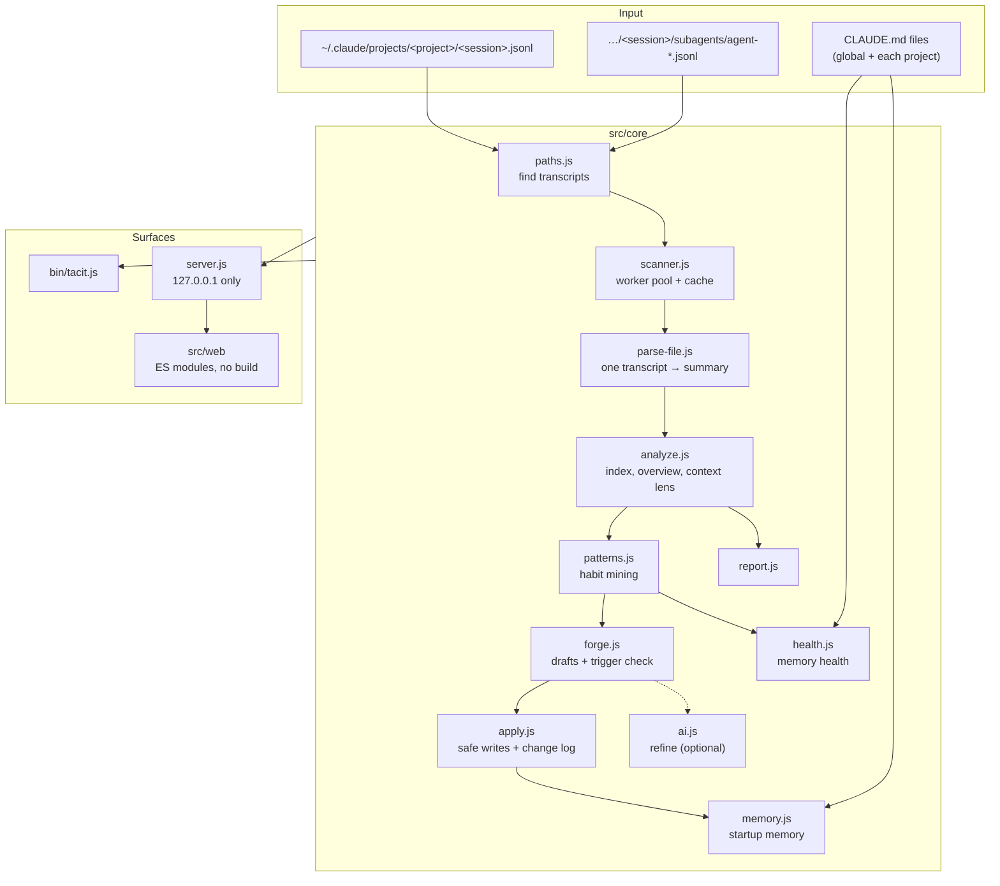

# Architecture

Tacit is a single Node.js process with no required dependencies. It reads Claude Code transcripts, builds an in-memory
index, and serves a local web UI and JSON API. Everything below `src/core` is plain functions over plain data, so the CLI,
the server and the tests share the same code.

## Reading transcripts

Claude Code writes one JSON object per line. A session file mixes many record types: user turns, assistant turns,
tool results, summaries, cost snapshots, file-history snapshots and request logs. Large sessions reach 90 MB.

`parse-file.js` streams each file with `readline` and:

- skips record types that start with `{"type":"<skip>"` without calling `JSON.parse` (file history, request logs, queue
  operations, etc.);
- treats a user turn as *typed by a person* only when it is not meta, not a compact summary, not a tool result, not inside
  a subagent transcript, and (on newer versions) has `origin.kind === "human"`;
- strips wrappers injected around typed text (`<system-reminder>`, `<ide_selection>`, command wrappers), and redacts
  secrets before anything is stored;
- counts usage once per message id (Claude Code writes the same assistant message once per content block, each copy
  carrying the full usage);
- records the context size of every turn (`input + cache_read + cache_creation`), compactions, tool calls, the heaviest
  tool outputs, files read and edited, shell command signatures, subagent and skill use, and Claude Code's own cost record.

The result is a compact summary per file. `scanner.js` parses files in a `worker_threads` pool (biggest first), falls back to
serial parsing for small histories or if workers are unavailable, and caches summaries in `~/.tacit/cache` keyed by file
size and mtime. A parser version number invalidates the cache when the format changes.

## Finding habits

`patterns.js` works in three steps.

1. **Candidates.** Each typed prompt is split into clauses (list items, sentences, "and also…"). Pasted documents (prompts
   with markdown headings, bold, tables or code fences) are excluded here. Each clause gets a *directive score*:
   imperative openings, standing-instruction words ("always", "never", "from now on", "make sure") and corrections ("you
   forgot", "again", "I told you") raise it; questions, file names and line numbers lower it.
2. **Grouping.** Clauses are compared by character trigrams, which survive typos ("wnat" ≈ "want"). MinHash with 48 hashes
   in 16 bands finds candidate pairs in near-linear time; pairs above 0.42 Jaccard similarity are joined with union-find.
   A lexicon of common developer habits (tests, package manager, plan first, minimal changes, simple language, …) joins
   phrasings that share few characters.
3. **Ranking and classification.** A group needs repeats in at least two sessions (or a correction loop inside one). The
   score weighs count, sessions, projects, how directive the wording is, and recency. Groups whose repeats all come from one
   long prompt pasted again are left to the brief detector, which compares whole long prompts and suggests slash commands.

## Drafting

`forge.js` renders each artifact from a template that follows Claude Code's formats:

| Kind | File | Notes |
|---|---|---|
| Rule | `CLAUDE.md` (project) or `~/.claude/CLAUDE.md` | Appended under `## Working agreements`; known habits get a precise, checkable sentence. |
| Skill | `.claude/skills/<name>/SKILL.md` | The description includes the user's own phrasings, because the description decides whether Claude loads it. |
| Hook | `.claude/settings.json` | Stop hooks exit with code 2 to keep Claude working while tests, lint or types fail; the command is detected from the project. |
| Subagent | `.claude/agents/<name>.md` | Read-only tools for review and research, fixed reply format, obstacle reporting. |
| Command | `.claude/commands/<name>.md` | The reused brief with `$ARGUMENTS`. |

The **trigger check** is an offline eval: it scores every prompt in the history against the description's key terms
(IDF-weighted), picks the threshold with the best F1, and reports recall on the habit's own requests, false positives on
everything else, and examples of each.

## Writing files

`apply.js` writes only inside an allowed root (a project folder from the history, or the Claude config folder), checked
after resolving the path. Existing files are copied to `~/.tacit/backups/<timestamp>/` first and written atomically via a
temporary file. Rules are de-duplicated by similarity, hooks are merged into `settings.json` (an invalid file aborts the
write), and new files are never replaced without an explicit overwrite.

## Startup memory

`memory.js` lists the files Claude Code loads at startup: `CLAUDE.md` in the Claude config folder, and `CLAUDE.md`,
`.claude/CLAUDE.md` and `CLAUDE.local.md` in each project folder from the history. For each file it extracts list-item
rules with their heading and line, resolves `@` imports (skipping code spans and fences), and estimates tokens.

- **Switch off** renames `CLAUDE.md` to `CLAUDE.md.disabled`; switching on renames it back.
- **Pause** removes the rule's line (found by line number, or by text if the file changed) and stores it in
  `~/.tacit/parked-rules.json` keyed by the file path, together with its heading, so it can be appended back to the same section.
- **Edit, add, remove, restore** all go through `backupFile` and `atomicWrite` from `apply.js`.
- Every write, including drafts saved from Repeats, is appended to `~/.tacit/history.json` (newest first, capped at 500).
  Rules whose text matches a logged addition are marked *Added by Tacit*.
- Diffs use a longest-common-subsequence line diff with unchanged runs collapsed.

Every path is checked twice: the file name must be `CLAUDE.md` or `CLAUDE.local.md`, and the resolved path must sit inside
an allowed root. State-changing endpoints also require `confirm: true` in the body.

## Server

`server.js` uses `node:http`. It binds to `127.0.0.1`, rejects any `Host` header that is not a localhost name (DNS-rebinding
defence), requires a random per-launch token for non-GET requests, refuses foreign `Origin` headers, limits request bodies
to 1 MB, sets a strict CSP, and serves static files only from `src/web`. Scan progress is pushed over Server-Sent Events.

## Refine with Claude

`ai.js` loads the official `@anthropic-ai/sdk` lazily, so it stays an optional dependency. Requests use `claude-opus-5-5`
at `medium` effort, put the stable instructions in a cached system block, and ask for the result through a `strict` tool
so the reply is always a complete artifact. Server-side refusal fallbacks are requested, and SDK errors are mapped to plain
messages. The alternative engine runs `claude -p --output-format json` and reads the artifact from tagged output.

## Performance

On a real history of 245 transcripts (1.7 GB): about 4 s for the first scan on a 6-core laptop, 60–100 ms with the cache,
and under 0.5 s for habit mining.
