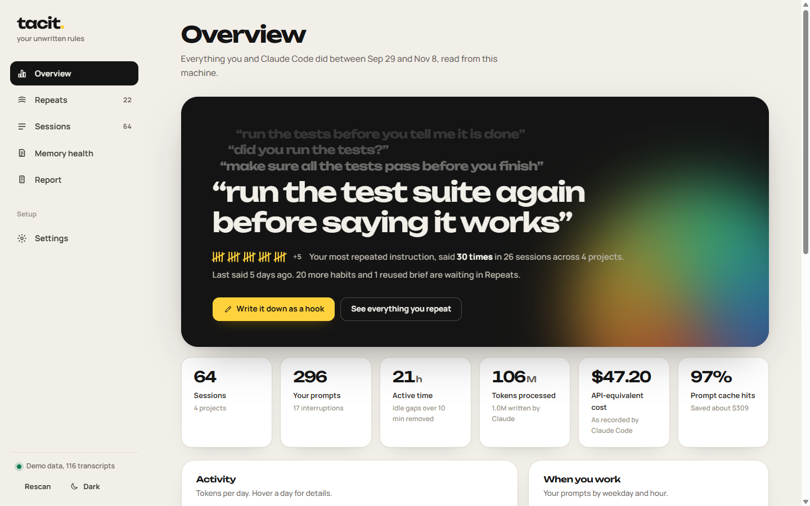
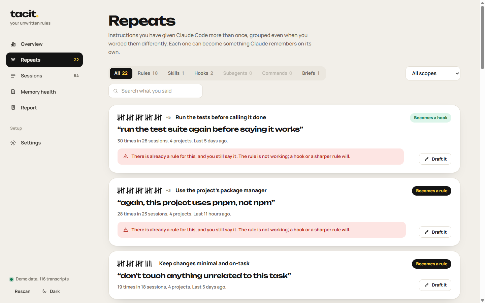
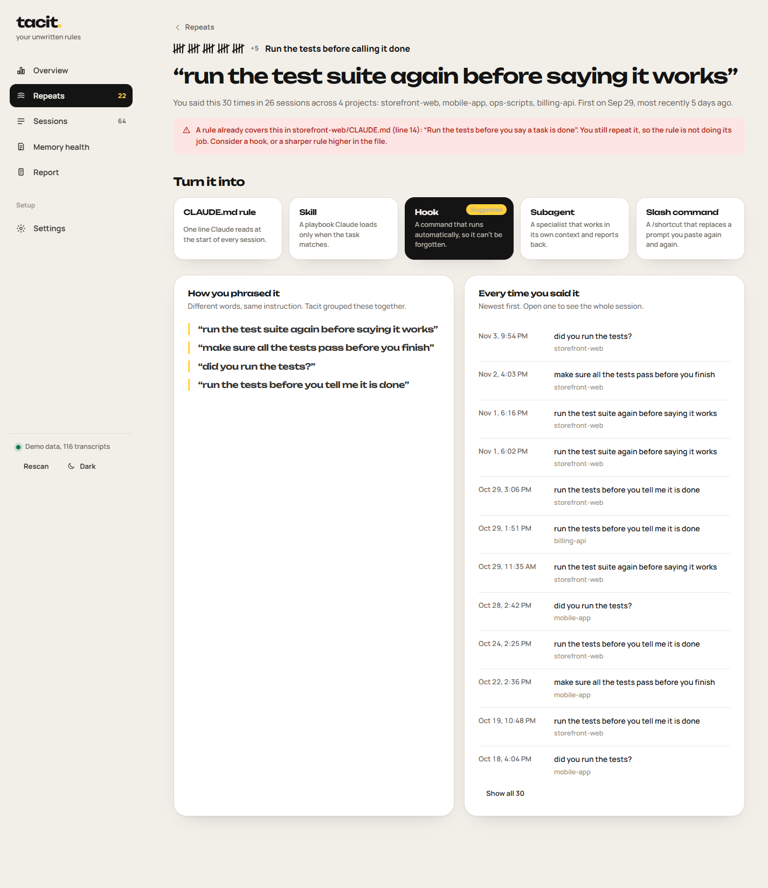
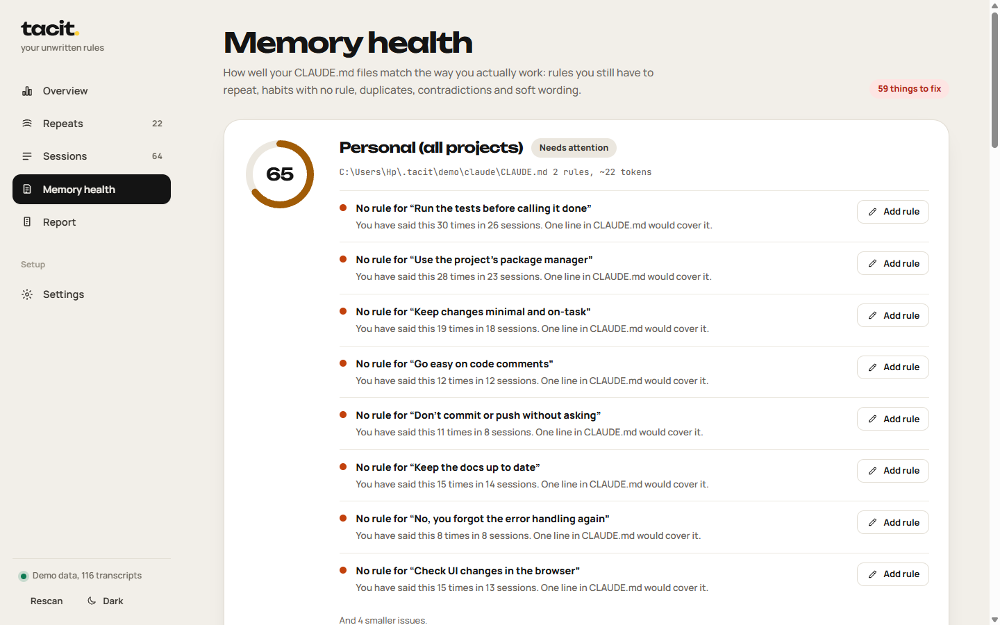

# Tacit manual

## Install

1. Install [Node.js](https://nodejs.org) 18.17 or newer. Check with `node -v`.
2. Get Tacit:
   ```bash
   git clone https://github.com/abuhuraira99/tacit.git
   cd tacit
   ```
3. Optional: `npm install`. This only adds the Anthropic SDK, used by **Refine with Claude**. Everything else works without it.
4. Start it: `npm start`. Your browser opens at `http://localhost:4317`.

To use the `tacit` command from any folder, run `npm link` once inside the project.

## First run

Tacit looks for Claude Code history in `~/.claude/projects` (or `$CLAUDE_CONFIG_DIR/projects`). The first read takes a few
seconds for a large history; after that, only changed files are read again.

No history? Run `npm run demo` to explore with generated data.

## Overview



- **The black card** shows the instruction you repeat most, with earlier phrasings above it and a tally of how often you said
  it. *Write it down* jumps straight to a draft.
- **Totals**: sessions, your prompts, active time (idle gaps over 10 minutes are removed), tokens, API-equivalent cost (what
  Claude Code recorded, or an estimate from list prices) and prompt cache hits.
- **Charts**: tokens per day, when you work, tools Claude used, shell commands it ran, projects, models, and the subagents,
  skills and slash commands that ran.

## Repeats



Every instruction you gave in more than one session. Filter by what it should become, by scope (across projects or one
project), or search. A red note means a rule for it already exists in a CLAUDE.md and you still repeat it, so the rule is not
working and needs to be sharper or enforced with a hook.

Open a repeat to see every phrasing you used and every time you said it, with links to the sessions.

## Drafts



1. Pick what it should become on the left: rule, Skill, hook, subagent or slash command. *Suggested* marks Tacit's pick.
2. Choose where it applies: **Every project** writes to your personal `~/.claude`, **One project** writes into that project.
3. Edit the draft freely.
4. **Save to file** shows exactly which file changes and how, then writes it with a backup. Or **Copy** / **Download**.

For Skills and subagents, the **Trigger check** shows whether the description would have matched your past requests:
how many of this habit's requests it catches, its precision, and examples it missed or would wrongly fire on. Edit the
description and click *Check the edited description* to test again.

## Sessions

Every conversation, sortable by date, cost, tokens, peak context or prompts. Open one for:

- **Context over the session**: how full the context window was at each turn, with compactions marked.
- **What stands out**: oversized tool outputs, files read three or more times, frequent interruptions, very long contexts.
- **What you asked**, the **biggest tool outputs**, **tools used** and details (folder, models, lines changed, version).

## Memory health



A score for your personal CLAUDE.md and each project's, with issues ranked by severity:

| Issue | Meaning |
|---|---|
| Rule exists, but you still repeat it | The rule is too vague, too far down, or needs a hook. *Enforce it* drafts the hook. |
| No rule for … | A habit you repeat that no CLAUDE.md covers. *Add rule* drafts it. |
| Long file | Over ~5k tokens loads into every session; move detail into Skills or imported files. |
| Duplicate / contradiction | Two rules saying the same, or opposite, things. |
| Soft wording | "Try to", "if possible", "ideally": easy to skip. |

## Report

A Markdown retrospective: totals, the habits you repeat with suggested fixes, reused briefs, memory health and your heaviest
sessions. Copy it or download a `.md` file.

## Settings

- **History folder**: point Tacit at another Claude Code folder, for example a copy from another machine.
- **Refine with Claude**: choose the engine (automatic, Claude API, Claude Code, or templates only), the model, and an API key
  for this run only.

## Files Tacit creates

| Path | Purpose |
|---|---|
| `~/.tacit/cache/` | Parsed summaries, so the next start is instant. Safe to delete. |
| `~/.tacit/backups/` | A copy of every file before Tacit changed it. |
| `~/.tacit/demo/` | Sample history and projects for `--demo`. |

## Uninstall

Delete the `tacit` folder and `~/.tacit`. If you ran `npm link`, run `npm unlink -g tacit` first.
